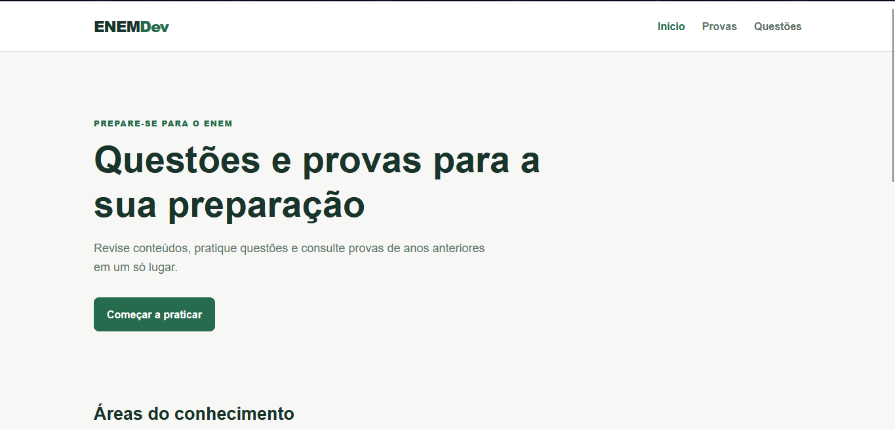

# ENEM Dev

O ENEM Dev é um site estático para consultar provas anteriores e praticar
questões do ENEM. Ele não possui servidor próprio: o navegador busca os dados
diretamente na API pública [enem.dev](https://docs.enem.dev/introduction).

## O que há no site

- **Início:** apresenta as quatro áreas do conhecimento cobradas no ENEM.
- **Provas:** mostra os anos disponíveis e os detalhes de cada edição.
- **Questões:** permite escolher o ano, a área e o idioma de língua estrangeira,
  abrir uma questão e conferir a resposta após a tentativa.

## Preview do site



## Como testar localmente

Este projeto deve ser aberto com uma extensão de servidor local, pois o site
faz requisições para a API pela internet.

No Visual Studio Code:

1. Instale a extensão **Live Server**, caso ela ainda não esteja instalada.
2. Abra a pasta do projeto no VS Code.
3. Abra o arquivo `index.html`.
4. Clique com o botão direito no editor e escolha **Open with Live Server**.

O navegador abrirá uma URL parecida com `http://127.0.0.1:5500`. O `index.html`
encaminha para a página inicial em `web/home.html`.

Para testar as demais páginas diretamente, use os links de navegação do site ou
abra `web/enem.html` e `web/questoes.html` pelo servidor do Live Server.

## Como a API é usada

O código da integração está em `web/script.js`. A URL-base é:

```
https://api.enem.dev/v1
```

Todas as consultas são feitas com o método `GET`. Quando uma página precisa de
informações, o navegador envia uma requisição para a API, recebe os dados em
formato JSON e o JavaScript monta os cards, filtros e detalhes na tela.

### Rotas usadas pelo projeto

| Objetivo | Rota | Onde é usada |
| --- | --- | --- |
| Listar as provas disponíveis | `/exams` | páginas **Provas** e **Questões** |
| Consultar os detalhes de uma prova | `/exams/{ano}` | ao selecionar um ano em **Provas** |
| Listar as questões de uma prova | `/exams/{ano}/questions` | página **Questões** |
| Abrir uma questão | `/exams/{ano}/questions/{indice}` | ao clicar em uma questão |

Substitua `{ano}` pelo ano do ENEM e `{indice}` pelo número da questão. Por
exemplo, a lista de provas é obtida em:

```
https://api.enem.dev/v1/exams
```

E esta URL busca questões do ENEM 2023 em inglês:

```
https://api.enem.dev/v1/exams/2023/questions?limit=50&offset=0&language=ingles
```

### Parâmetros das questões

A rota de questões aceita parâmetros na URL. O projeto usa os seguintes:

| Parâmetro | Exemplo | Função |
| --- | --- | --- |
| `limit` | `50` | Define quantas questões são retornadas por requisição. |
| `offset` | `0`, `50`, `100` | Indica a partir de qual questão a próxima página será carregada. |
| `language` | `ingles` ou `espanhol` | Define o idioma das questões de língua estrangeira. |

Depois de receber todas as páginas de questões, o site filtra a área escolhida
no próprio navegador. As áreas disponíveis são `linguagens`,
`ciencias-humanas`, `ciencias-natureza` e `matematica`.

### Exemplo de uso em JavaScript

```js
const resposta = await fetch('https://api.enem.dev/v1/exams');
const provas = await resposta.json();

console.log(provas);
```

Em `web/script.js`, a função `buscarNaApi(rota)` concentra esse processo. Ela
monta a URL completa, executa o `fetch` e retorna o JSON. Caso a API responda
com `429` — limite temporário de requisições — o site aguarda 1,2 segundo e
tenta mais uma vez antes de exibir um erro.

Para consultar todos os campos disponíveis, limites e demais filtros, acesse a
[documentação da API enem.dev](https://docs.enem.dev/).
